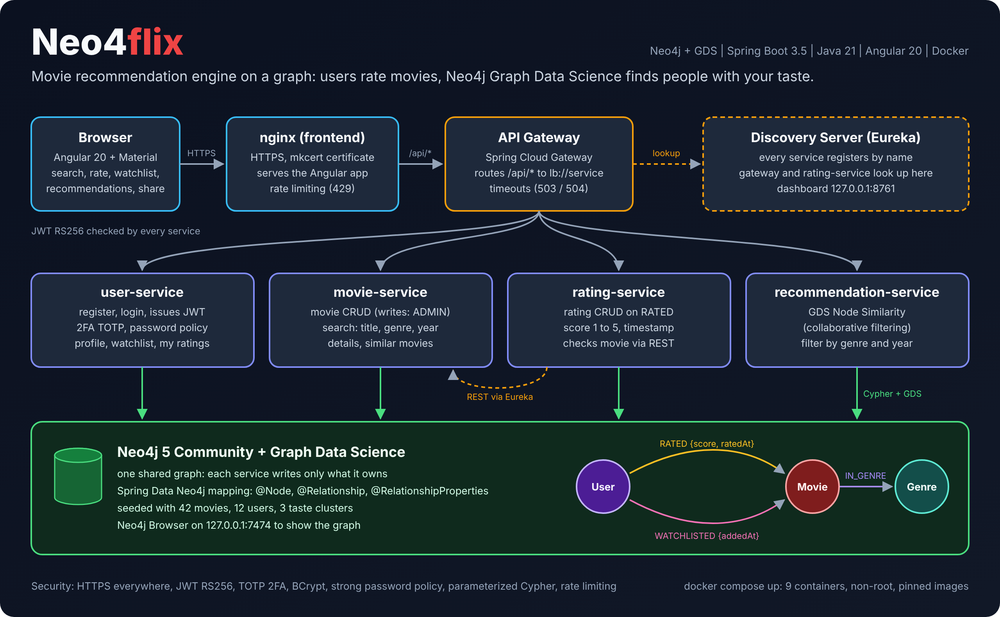

# Neo4flix



Movie recommendation engine on a graph. Users rate movies, and Neo4j Graph Data Science finds people with the same taste to recommend what they liked. Spring Boot microservices, Angular frontend, everything in Docker.

## How it fits together

| Part | Role |
|---|---|
| nginx (frontend) | Serves the Angular app over HTTPS, rate limits, proxies `/api/*` to the gateway |
| api-gateway | Single entry to the backend, routes `/api/*` to services found by name in Eureka |
| discovery-server | Eureka registry: every service registers here |
| user-service | Register, login, JWT, 2FA (TOTP), profile, watchlist, my ratings |
| movie-service | Movie CRUD (writes need ADMIN), search by title, genre and year, similar movies |
| rating-service | Rate a movie 1 to 5, update, delete |
| recommendation-service | Personalized recommendations with GDS Node Similarity, filter by genre and year |
| neo4j | One shared graph: `(:User)-[:RATED {score, ratedAt}]->(:Movie)-[:IN_GENRE]->(:Genre)`, plus `WATCHLISTED {addedAt}` |

Every service checks the JWT (RS256) itself. Only user-service holds the private key that signs tokens.

## Run it

Prerequisites: Docker, mkcert, openssl, curl.

```bash
./scripts/setup.sh          # once: .env, JWT keys, local HTTPS certificate, GDS plugin
docker compose up --build
```

Services take 30 to 60 seconds to register with Eureka. A 503 right after startup means "not registered yet".

| URL | What |
|---|---|
| https://localhost | The app |
| http://127.0.0.1:8761 | Eureka dashboard (registered services) |
| http://localhost:7474 | Neo4j Browser (user `neo4j`, password in `.env`) |

## Demo accounts

Local demo data only. Every seeded user has the password `Neo4flix-Demo-2026!`

| Username | Role | Taste |
|---|---|---|
| admin | USER, ADMIN | mixed |
| neo, trinity, ripley, deckard | USER | science fiction |
| andy, red, vito, forrest | USER | drama |
| woody, nemo | USER | animation |
| newbie | USER | no ratings (cold start) |

Log in as `neo` and the recommendations are science fiction. Log in as `andy` and they are drama.

## Repository

```
backend/     Maven multi-module: common, discovery-server, api-gateway and the four services
frontend/    Angular app and nginx config
seed/        seed.cypher: genres, 42 movies, 12 users, ratings
scripts/     setup.sh
docs/        subject, audit, design decisions, audit checklist
```

Design choices and their reasons: [docs/decisions.md](docs/decisions.md).
